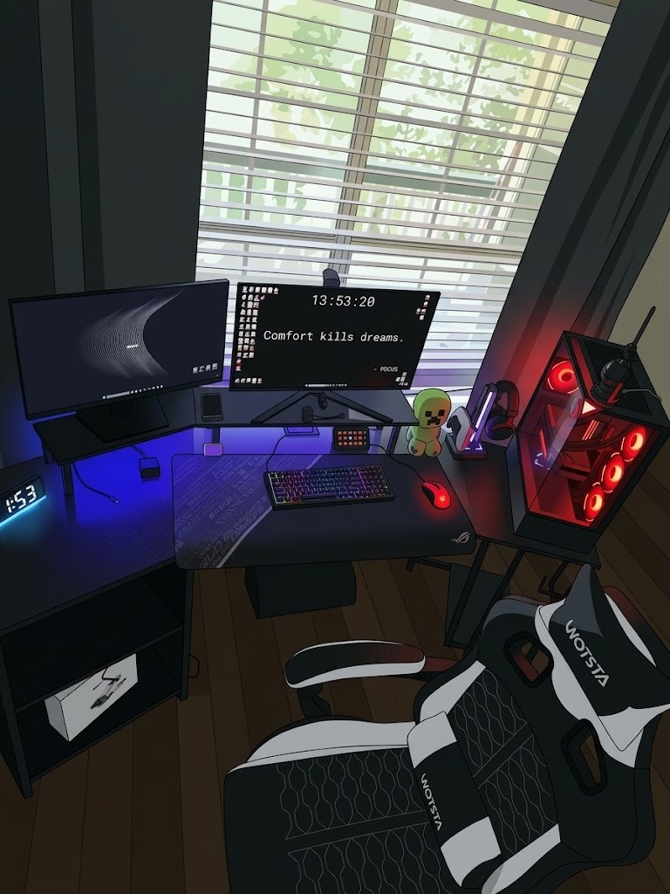

<div align="center">


# LotusLED Desk

**Controla desde tu PC las tiras LED Bluetooth de la app LotusLamp X, sin el teléfono.**

Color · brillo · 22 efectos · modo música · ambilight · se enciende con Windows y se apaga con el PC




</div>

---

## ¿Qué es?

Muchas tiras LED baratas para el monitor o el escritorio se manejan con la app móvil **LotusLamp X**.
LotusLED Desk habla directamente con esas tiras por **Bluetooth LE** desde Windows, así que puedes
controlarlas desde el PC con una interfaz moderna que reacciona a tu música o a tu pantalla.

**Controladores compatibles:** `L7179`, `ELK-BLEDOM`, `MELK`, `LEDDMX`, `BJ_LED`, `Triones` y otros
que usan el protocolo de tramas `7E … EF` (servicio `FFF0`, característica `FFF3`).

## Funciones

| | |
|---|---|
| 🎨 **Color** | Rueda interactiva, código HEX, temperatura de blanco y favoritos |
| ✨ **Efectos** | 22 efectos dinámicos (salto, respiración, fundido, destello) con control de velocidad |
| 🎵 **Modo música** | Espectro, pulso, arcoíris o golpe al ritmo del audio del PC o del micrófono |
| 🖥️ **Ambilight** | Las luces copian en tiempo real el color dominante de tu pantalla |
| ⏻ **Automático** | Se enciende al iniciar Windows y se apaga al apagar o reiniciar el PC, sin abrir ninguna ventana |
| 🔔 **Bandeja** | Icono en la bandeja del sistema para encender/apagar sin abrir la ventana |
| ⏲️ **Temporizador** | Apagado programado |

## Instalación

1. Descarga el proyecto (**Code → Download ZIP**) y descomprímelo donde quieras.
2. Cierra LotusLamp X en el móvil (la tira solo acepta una conexión a la vez).
3. Haz doble clic en **`Instalar.bat`**. Compila el ayudante, busca tu tira la primera vez (te pregunta cuál
   es la tuya y la guarda en `device.cfg`) y lo deja todo listo.

Desde ese momento, al iniciar Windows las luces se encienden solas **sin abrir ninguna ventana**, y al apagar,
reiniciar o cerrar sesión se apagan. Para cambiar el color, abre **LotusLED Desk** desde el Escritorio y pulsa
**Conectar tiras**. Para quitarlo todo: **`Desinstalar.bat`**.

> **Requisitos:** Windows 10/11 con Bluetooth, y Microsoft Edge o Google Chrome (la interfaz usa Web Bluetooth).

## Cómo funciona

```
LotusShutdown.exe ─► ayudante sin ventana que arranca con Windows: enciende las tiras al iniciar sesión y,
                     cuando Windows avisa de que se apaga, lo retiene unos segundos hasta que les llega la orden
                     de apagado (funciona aunque la interfaz esté cerrada)

LotusLED.ps1 ──► servidor local http://localhost:8787 ──► ventana Edge/Chrome (modo app)
     │                                                        │
     └─ icono en la bandeja del sistema                       └─ web/ (interfaz + Web Bluetooth → tira LED)

LotusLED.exe      ─► versión alternativa 100% nativa (WinForms + Bluetooth de WinRT)
```

| Carpeta / archivo | Qué hace |
|---|---|
| `web/` | Interfaz (HTML/CSS/JS): `ble.js` protocolo Bluetooth, `sync.js` música y ambilight, `app.js` lógica |
| `LotusLED.ps1` | Lanzador: servidor local y bandeja del sistema |
| `src/` | Código C# de la versión nativa (`LotusLED.exe`) y del ayudante `LotusShutdown.exe` |
| `build.ps1` | Compila los dos `.exe` con el compilador que ya trae Windows |
| `Instalar.ps1` / `Desinstalar.ps1` | Accesos directos, el ayudante al iniciar Windows y una tarea de respaldo |

## Compilar los .exe

No necesitas Visual Studio:

```powershell
powershell -ExecutionPolicy Bypass -File build.ps1
```

`LotusShutdown.exe` necesita la MAC de tu tira en `device.cfg`, junto al `.exe` (una por línea, por ejemplo
`AA:BB:CC:DD:EE:FF`). `Instalar.bat` la busca y la guarda por ti. Ese archivo no se sube a GitHub.

| Uso | Qué hace |
|---|---|
| `LotusShutdown.exe -watch -on` | Lo que se arranca con Windows: enciende las tiras y se queda vigilando el apagado |
| `LotusShutdown.exe` | Apaga las tiras ahora |
| `LotusShutdown.exe -on` | Las enciende ahora |
| `LotusShutdown.exe -probe` | Comprueba que llega a las tiras sin cambiar las luces (el resultado va al registro) |

Lo que hace queda apuntado en `%LOCALAPPDATA%\LotusLED\LotusShutdown.log`: ahí se ve si la orden llegó
al apagar y cuánto tardó.

Lo que no cubre: suspender o hibernar el PC (Windows no avisa a los programas; si el botón de encendido está
puesto en "suspender", tampoco) y los cortes de luz.

## Protocolo (para curiosos)

Cada comando es una trama de 9 bytes (controladores ELK-BLEDOM):

| Acción | Trama |
|---|---|
| Encender | `7E 00 04 F0 00 01 FF 00 EF` |
| Apagar | `7E 00 04 00 00 00 FF 00 EF` |
| Color RGB | `7E 00 05 03 RR GG BB 00 EF` |
| Brillo (0–100) | `7E 00 01 BB 00 00 00 00 EF` |
| Efecto | `7E 00 03 ID 03 00 00 00 EF` |
| Velocidad (0–100) | `7E 00 02 VV 00 00 00 00 EF` |

## Licencia

[MIT](LICENSE): úsalo, modifícalo y compártelo libremente.

---

<div align="center">Hecho por <b>Leivis</b> para su setup 💡</div>
